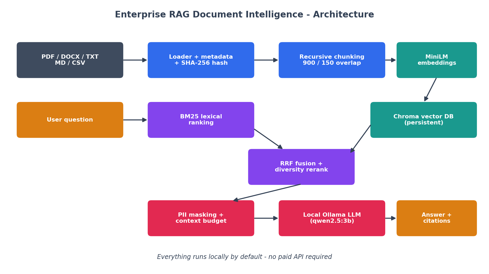
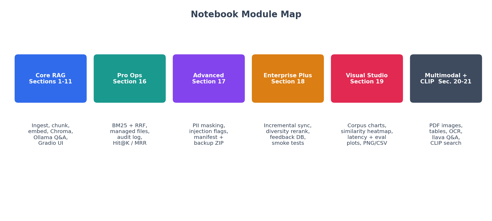
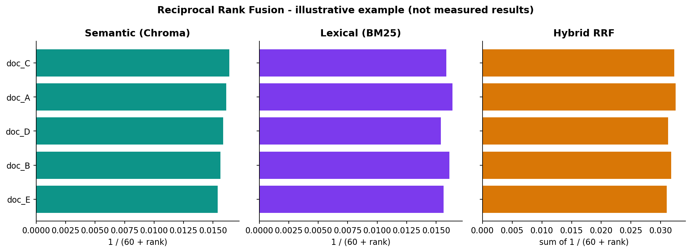
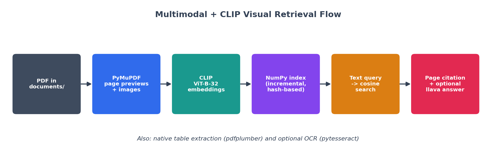
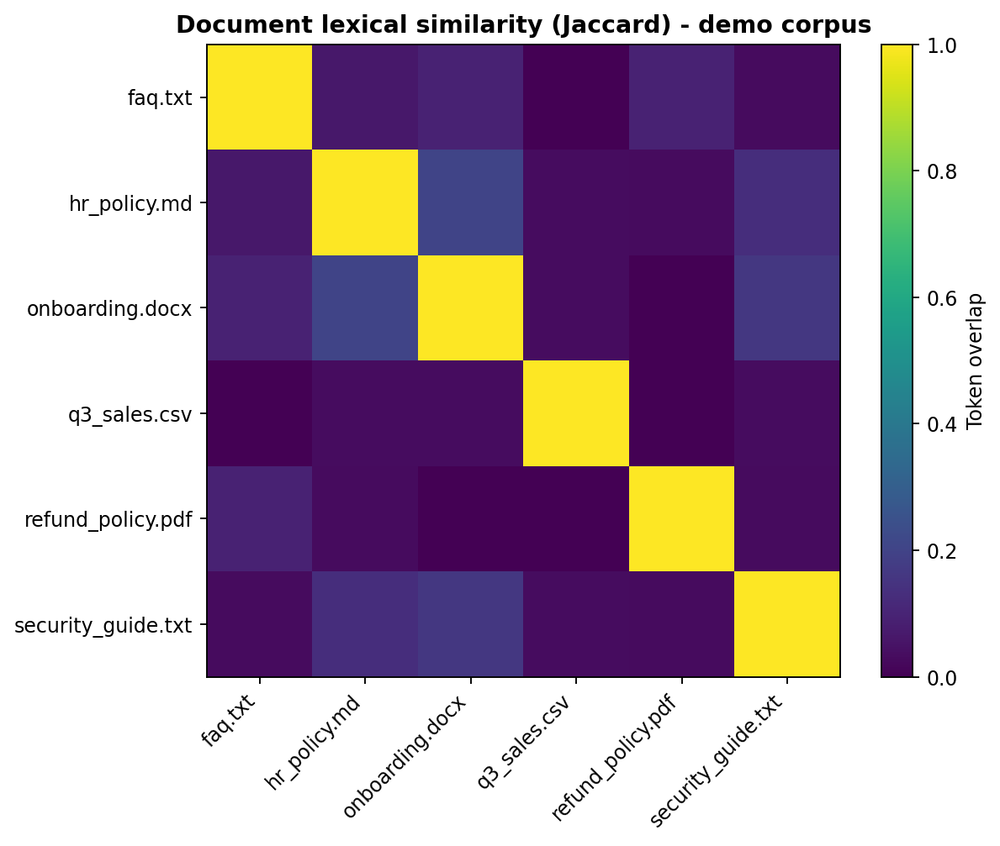
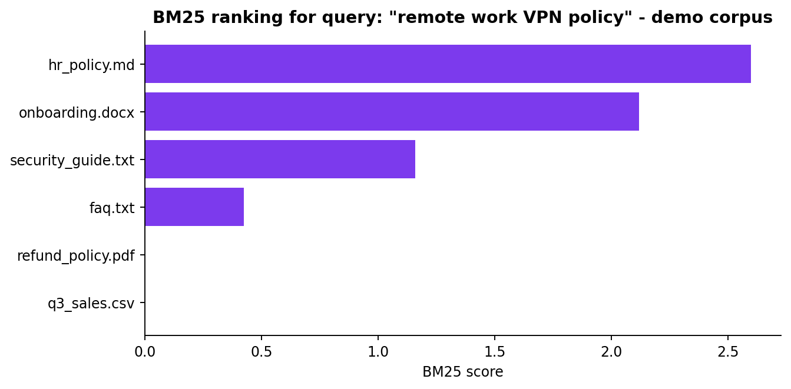

# 📚 Enterprise RAG Document Intelligence — Visual Retrieval Pro

A **local-first, source-grounded document assistant** built in a single Jupyter/Colab notebook. Ask questions about your own PDFs, Word files, text, Markdown and CSV files, get answers with **page-level citations**, and search charts and page images with **CLIP visual retrieval** — all without a paid API.

> **Notebook:** [`Enterprise_RAG_Document_Intelligence_Visual_Retrieval_Pro.ipynb`](notebooks/Enterprise_RAG_Document_Intelligence_Visual_Retrieval_Pro.ipynb)



---

## ✨ Features

| Area | What you get |
|---|---|
| **Ingestion** | PDF, DOCX, TXT, MD, CSV loaders · SHA-256 file hashes · page metadata · unreadable files skipped with a clear warning |
| **Chunking & storage** | Recursive chunking (900 chars / 150 overlap) · stable chunk IDs · persistent **Chroma** vector store |
| **Embeddings & LLM** | `sentence-transformers/all-MiniLM-L6-v2` on CPU · local **Ollama** chat model (default `qwen2.5:3b`) |
| **Retrieval** | MMR, weighted semantic + keyword scoring, **BM25 + Reciprocal Rank Fusion (RRF)**, filename filters, diversity-aware reranking |
| **Grounded answers** | "Answer only from context" prompt · prompt-injection-aware system prompt · `[1]`, `[2]` citation labels with validity check · abstains when evidence is missing |
| **Privacy & safety** | Regex PII masking (email, phone, PAN) · injection-marker flags · no raw questions stored in analytics · loopback-only Gradio |
| **Operations** | Managed add/delete with reindex · incremental sync manifest · audit log (JSONL) · health report · integrity manifest + ZIP backup · SQLite feedback store |
| **Evaluation** | Known-answer harness · retrieval **Hit@K** and **MRR** · regression gate with thresholds · smoke tests |
| **Visual analytics** | Document size, file-type, similarity heatmap, retrieval-method comparison, latency and evaluation charts · PNG/CSV export |
| **Multimodal** | PDF page previews and embedded images (PyMuPDF) · native table extraction (pdfplumber) · optional OCR · local vision Q&A (Ollama `llava`) |
| **Visual retrieval** | CLIP `clip-ViT-B-32` image embeddings · incremental hash-based index · cosine search · duplicate suppression · page-cited results |
| **Interfaces** | Four optional **Gradio** apps: chat/summarize/compare/export, operations console, visual analytics studio, visual retrieval studio |

---

## 🗺️ Notebook Map



| Section | Topic |
|---|---|
| 1–3 | Install, settings, document upload |
| 4–6 | Ingestion, chunking, embeddings, Chroma |
| 7–8 | Ollama LLM and grounded answer generation |
| 9–11 | Retrieval diagnostics, evaluation harness, latency chart |
| 12 | Gradio chat app (chat, summarize, compare, export) |
| 13–15 | Security notes, export helpers, GitHub checklist |
| 16 | Pro operations: BM25 + RRF, managed files, audit log, console |
| 17 | Advanced: PII masking, citation checks, analytics, manifest/backup |
| 18 | Enterprise Plus: incremental sync, diversity rerank, feedback, smoke tests |
| 19 | Visual Intelligence Studio (charts and comparisons) |
| 20 | Multimodal: PDF images, tables, OCR, vision Q&A |
| 21 | CLIP automatic visual retrieval |

---

## 🔎 How Hybrid Retrieval Works

Semantic search finds passages with similar *meaning*; BM25 finds passages with matching *keywords*. **RRF** merges the two rankings using only rank positions, so their different score scales never need to be compared.



> The chart above is an **illustrative example** of the RRF formula (`1 / (60 + rank)`), not a measured result.

---

## 🖼️ Visual Intelligence

### Multimodal and CLIP retrieval flow



Extract page previews and embedded images from a PDF, embed them with CLIP, then search them using plain-English queries such as *"bar chart showing year-over-year sales growth"*. Results come back with **file and page citations**. Optionally, a local vision model explains the top matches.

### Corpus analytics (sample output)

The two charts below were produced with the notebook's own BM25 and Jaccard-similarity logic, run on a **small demo corpus** of six short files (HR policy, security guide, refund policy, and similar). Your charts will reflect your documents.

| Document similarity heatmap | BM25 ranking for a sample query |
|---|---|
|  |  |

---

## 🚀 Quick Start

### 1. Prerequisites
- Python 3.10+
- [Ollama](https://ollama.com) installed locally, with a model pulled:
  ```bash
  ollama pull qwen2.5:3b      # text Q&A
  ollama pull llava           # optional: image questions
  ```
- A hosted Colab runtime **cannot** reach Ollama on your own PC. Run the notebook locally (or expose a model endpoint you control).

### 2. Install
```bash
git clone https://github.com/<your-username>/enterprise-rag-document-intelligence.git
cd enterprise-rag-document-intelligence
python -m venv .venv && source .venv/bin/activate   # Windows: .venv\Scripts\activate
pip install -U langchain-core langchain-community langchain-chroma langchain-huggingface \
  langchain-text-splitters langchain-ollama sentence-transformers chromadb pypdf python-docx \
  gradio pandas matplotlib numpy
# Multimodal and visual retrieval (Sections 20–21):
pip install pymupdf pillow requests pdfplumber pytesseract torch
```
OCR also needs the **Tesseract** system package.

### 3. Run
1. Put your files in `documents/`.
2. Open the notebook and run the cells **in order** (Sections 1 → 8 build the core index).
3. Ask a question:
   ```python
   result = ask_documents("What is the policy on remote work?")
   print(result["answer"])
   ```
4. Optional: run later sections and launch a Gradio app (always local):
   ```python
   app.launch(server_name="127.0.0.1", share=False)
   ```

---

## ⚙️ Configuration

| Setting | Default | Purpose |
|---|---|---|
| `CHUNK_SIZE` / `CHUNK_OVERLAP` | 900 / 150 | Chunking behaviour |
| `TOP_K` / `FETCH_K` | 5 / 15 | Final and candidate result counts |
| `EMBEDDING_MODEL` | `all-MiniLM-L6-v2` | Text embeddings |
| `OLLAMA_MODEL` | `qwen2.5:3b` | Text LLM |
| `RAG_VISION_MODEL` (env) | `llava` | Vision LLM |
| `RAG_CLIP_MODEL` (env) | `clip-ViT-B-32` | Image embeddings |
| `OLLAMA_URL` (env) | `http://127.0.0.1:11434` | Ollama endpoint |
| `MAX_FILE_BYTES` | 30 MiB | Upload size limit |

---

## 🧪 Evaluate Retrieval Quality

Add labelled questions with facts you are allowed to share:

```python
RETRIEVAL_TESTS = [
    {"question": "What is the refund policy?", "expected_source": "policy.pdf"},
]
gate, details = regression_gate(RETRIEVAL_TESTS, min_hit_at_k=0.80, min_mrr=0.60)
print(gate)
```

Hit@K and MRR measure **retrieval**, not answer correctness.

---

## 🔒 Privacy and Security

- Embeddings, the vector store and the LLM run **locally by default**.
- Never use `share=True` with confidential documents.
- Retrieved text is treated as **untrusted data**, and the model is told to ignore instructions inside documents. This is best-effort, not a guarantee.
- Regex PII masking is **not** full DLP.
- The notebook has **no authentication, tenant isolation, RBAC or encryption at rest**. It is a strong prototype, **not** a certified enterprise-secure product.

## ⚠️ Known Limitations

- Scanned PDFs need OCR; plain text extraction returns nothing for them.
- Keyword-based evaluation does not prove factual correctness. Citation checks verify that labels exist, not that claims are supported.
- Vision-model answers can misread charts. Verify numbers in the original PDF.
- CLIP works best with English queries.
- Incremental sync identifies files by basename, so keep filenames unique across subfolders.
- Do not run two kernels against the same Chroma collection.
- Gradio's API changes between major versions (for example `Chatbot(type=...)` and `Blocks(theme=...)`). If a UI cell errors, check your installed Gradio version and pin a compatible one.

## 📁 Suggested Repository Layout

```text
enterprise-rag-document-intelligence/
├── notebooks/
│   └── Enterprise_RAG_Document_Intelligence_Visual_Retrieval_Pro.ipynb
├── documents/            # your files (git-ignored)
│   └── .gitkeep
├── docs/
│   ├── images/
│   └── make_images.py    # regenerates the README diagrams
├── README.md
├── requirements.txt
├── .gitignore
└── LICENSE
```

Add these to `.gitignore`: `documents/*`, `vector_db/`, `rag_multimodal/`, `rag_visual_exports/`, `rag_audit.jsonl`, `rag_sync_manifest.json`, `rag_feedback.sqlite3`, `.env`.

## 🛠️ Tech Stack

Python · LangChain · ChromaDB · Sentence-Transformers · CLIP · Ollama (Qwen2.5, LLaVA) · PyMuPDF · pdfplumber · Tesseract · Gradio · Pandas · NumPy · Matplotlib

## 📄 License

Add a license of your choice (for example MIT) before publishing.

## 🙌 Author

**Harpreet Singh** — GitHub: [@harpreetsingh171190-cmyk](https://github.com/harpreetsingh171190-cmyk)
